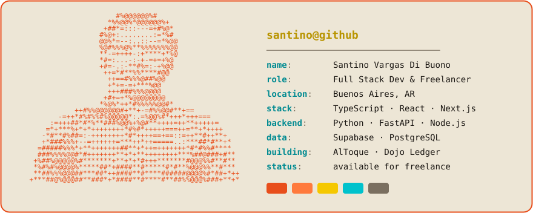
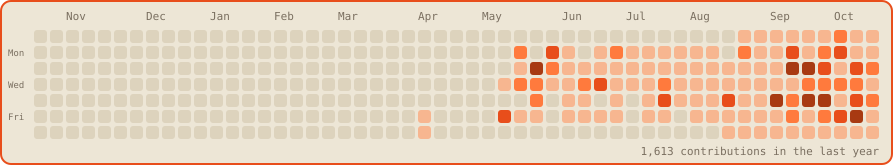

# Hey, I'm Santino 🔥

<a href="https://github.com/santinovargasdb">
  <picture>
    <source media="(prefers-color-scheme: dark)" srcset="ascii-portrait-dark.svg">
    
  </picture>
</a>

I build web apps end to end — from marketplaces with geo-matching and real-time chat to AI-powered monitoring systems running in production. Currently freelancing and open to new projects.

## ⚡ Tech Stack

**Frontend**&nbsp;&nbsp;

**Backend**&nbsp;&nbsp;

**Data & Infra**&nbsp;&nbsp;

## 🚀 Featured Projects

| Project | What it is | Stack |
| :--- | :--- | :--- |
| 🚨 **[AlToque](https://github.com/santinovargasdb/AlToque)** | PWA marketplace for urgent home services in Buenos Aires — PostGIS geo-matching, real-time chat and payments | `Next.js` `Supabase` |
| 🎴 **[Dojo Ledger](https://github.com/santinovargasdb/habits-tracker-app)** | Offline-first habit tracker with a gamified economy: collectible cards, gacha and a server-side RNG casino | `Next.js` `Supabase` |
| 🛍️ **[arcea](https://github.com/santinovargasdb/arcea-app)** | Full-stack e-commerce for a clothing brand — catalog, cart and checkout hardened with RLS and anti role-escalation | `Next.js` `Supabase` |
| 📡 **[social-media-filter-engine](https://github.com/santinovargasdb/social-media-filter-engine)** | Media & social monitor (X/IG/TikTok) for a press team — scraping, AI scoring (Gemini) and automated reports. **In production** | `FastAPI` `Next.js` |
| 🚚 **[LogiSwift](https://github.com/santinovargasdb/LogiSwift)** | Delivery logistics PWA — route sheets, vehicle stock and end-of-day sales close *(WIP)* | `React` `Supabase` |

## 📊 GitHub Stats

  
  

  

  <picture>
    <source media="(prefers-color-scheme: dark)" srcset="heatmap-dark.svg">
    
  </picture>

---

**📫 Got a project in mind?** Reach me at [santinovargasdb@gmail.com](mailto:santinovargasdb@gmail.com) or check my [portfolio](https://portfolio-web-sv.vercel.app).

